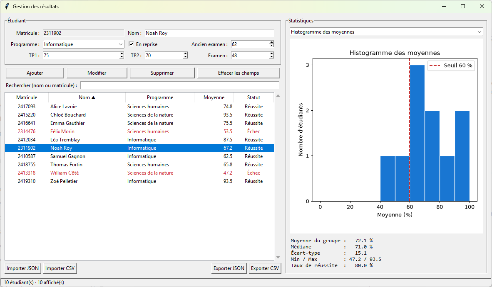

# Formatif de pratique : Gestion des résultats

Implémenter l'application suivante en respectant les contraintes ci-dessous. Le modèle va dans `model.py` (aucun import de tkinter) et l'interface dans `app.py`. Tous les widgets sont placés avec `grid()`.

Durée suggérée : 3 heures. Total : 100 points.



## Partie 1 : le modèle (35 points)

**Classe `Etudiant`.** Les attributs sont privés et exposés par des propriétés (getters/setters). Le constructeur passe par les setters pour profiter des validations.

- `matricule` : exactement 7 chiffres. **Lecture seule** : aucun setter.
- `nom` : chaîne non vide après `strip()`.
- `programme` : doit faire partie de `PROGRAMMES = ("Informatique", "Sciences de la nature", "Sciences humaines")`.
- `tp1`, `tp2`, `examen` : nombres réels entre 0 et 100. Accepter aussi la virgule (« 72,5 »).
- En cas de valeur invalide, lever une `ValueError` avec un message qui dit quel champ est fautif.

Méthodes :

- `moyenne()` : pondérée selon le dictionnaire `PONDERATIONS = {"tp1": 0.25, "tp2": 0.25, "examen": 0.50}` ;
- `statut()` : « Réussite » si la moyenne est d'au moins 60, sinon « Échec » ;
- `to_dict()` ;
- `__str__` (ex. `2412034 Léa Tremblay (Informatique) : 87.5 %`), `__repr__`, `__eq__` (deux étudiants sont égaux s'ils ont le même matricule) et `__lt__` (compare les moyennes, pour que `sorted()` fonctionne).

**Classe `EtudiantReprise(Etudiant)`.** Un étudiant qui reprend le cours garde la meilleure note entre son nouvel examen et son `ancien_examen` (0 à 100). Ne recopiez pas le calcul de `moyenne()` : redéfinissez seulement ce qui change. `__str__` et `to_dict()` réutilisent ceux de la classe parente avec `super()` et ajoutent `[reprise]` et `ancien_examen`.

**Exception `MatriculeDejaUtilise`**, qui hérite de `ValueError`.

**Fonction `etudiant_depuis_dict(d)`.** Elle reçoit un dictionnaire et retourne un `Etudiant` ou un `EtudiantReprise` selon la clé `"type"` (`"regulier"` ou `"reprise"`). Un champ manquant ou un type inconnu lève une `ValueError`, pas une `KeyError`.

**Classe `Groupe`**, avec une liste privée d'étudiants :

- `etudiants` : propriété qui retourne une **copie** de la liste ;
- `__len__` ;
- `ajouter(etudiant)` : `TypeError` si ce n'est pas un `Etudiant`, `MatriculeDejaUtilise` si le matricule existe déjà ;
- `trouver(matricule)`, `supprimer(matricule)`, `remplacer(matricule, nouvel_etudiant)` et `vider()` ;
- `rechercher(texte)` : étudiants dont le nom (sans tenir compte des majuscules) ou le matricule contient le texte ;
- `statistiques()` : avec **NumPy**, un dictionnaire avec le nombre d'étudiants, la moyenne, la médiane, l'écart-type, le min, le max et le taux de réussite en %. Retourne `None` si le groupe est vide ;
- `moyennes_par_programme()` : dictionnaire programme → moyenne, seulement pour les programmes présents.

## Partie 2 : l'interface (30 points)

Reproduire la fenêtre de l'image : titre « Gestion des résultats », formulaire en haut à gauche, tableau en dessous, statistiques à droite, barre d'état en bas. La fenêtre doit pouvoir s'agrandir : le tableau et le graphique prennent l'espace libre.

- Matricule et Nom dans des `Entry`, Programme dans un `Combobox` en lecture seule, les trois notes et l'ancien examen dans des `Spinbox` de 0 à 100.
- La case « En reprise » active ou désactive le champ « Ancien examen ».
- `Treeview` avec les colonnes Matricule, Nom, Programme, Moyenne (1 décimale) et Statut, plus une barre de défilement verticale. Les étudiants en échec s'affichent **en rouge** (`tag_configure`).
- La barre d'état affiche « 10 étudiant(s) · 10 affiché(s) ».

## Partie 3 : événements et validation (15 points)

- Le champ Matricule refuse au clavier tout ce qui n'est pas un chiffre et plus de 7 caractères (`validatecommand` avec `%P`).
- « Ajouter » reste désactivé tant que le matricule n'a pas 7 chiffres et que le nom est vide (`trace_add`). « Modifier » et « Supprimer » sont désactivés si aucune ligne n'est sélectionnée.
- Cliquer sur une ligne remplit le formulaire (`<<TreeviewSelect>>`), coche « En reprise » si c'est le cas, et rend le matricule non modifiable. « Modifier » remplace l'étudiant **à sa place**. On peut le faire passer de régulier à reprise.
- « Supprimer » demande une confirmation (`askyesno`). La touche Suppr dans le tableau fait la même chose.
- « Effacer les champs » (ou Échap) vide le formulaire et la sélection. Entrée ajoute l'étudiant.
- Le champ Rechercher filtre le tableau **à chaque touche**.
- Cliquer sur un en-tête trie par cette colonne. Un deuxième clic inverse l'ordre. L'en-tête affiche ▲ ou ▼.
- Toute erreur du modèle est affichée avec `showerror`. L'application ne doit jamais planter.

## Partie 4 : fichiers JSON et CSV (10 points)

- Exporter et importer en JSON (`ensure_ascii=False`, `indent=4`) et en CSV (`DictWriter` / `DictReader`, colonnes `type,matricule,nom,programme,tp1,tp2,examen,ancien_examen`).
- À l'import, chaque enregistrement passe par `etudiant_depuis_dict` pour être validé **avant** d'être ajouté. Les lignes valides sont ajoutées. Les lignes invalides sont rejetées et listées avec leur numéro de ligne dans le fichier.
- Un fichier illisible ou un JSON qui n'est pas une liste donne un `showerror`, et les données déjà chargées restent intactes.

## Partie 5 : statistiques et graphique (10 points)

- Graphique Matplotlib intégré (`Figure` + `FigureCanvasTkAgg`), redessiné après chaque changement.
- Un `Combobox` (`<<ComboboxSelected>>`) choisit entre :
    - un histogramme des moyennes (intervalles de 10) avec une ligne pointillée rouge au seuil de 60 % ;
    - un diagramme à barres de la moyenne par programme ;
    - un diagramme circulaire réussite / échec.
- Sous le graphique, afficher les statistiques de `Groupe.statistiques()`. Si le groupe est vide, afficher « Aucune donnée ».

## Pour vérifier ton travail

Les fichiers de test sont dans [donnees/](donnees/).

Après l'import de `groupe.json`, tu dois obtenir 10 étudiants, dont 2 en échec (Félix Morin et William Côté). Noah Roy doit avoir **67,2 %** : en reprise, son ancien examen de 62 compte au lieu de 48. Les statistiques attendues sont : moyenne 72,1 %, médiane 71,0 %, écart-type 15,1, réussite 80 %.

Ensuite, l'import de `nouveaux_avec_erreurs.csv` doit ajouter 3 étudiants et en rejeter 6 :

```
Ligne 4 : TP1 doit être entre 0 et 100 (reçu 105).
Ligne 5 : Le matricule doit contenir exactement 7 chiffres (reçu « 242055 »).
Ligne 6 : Programme inconnu : « Arts visuels ».
Ligne 7 : Le matricule 2412034 existe déjà.
Ligne 8 : Ancien examen doit être un nombre.
Ligne 9 : Le nom est obligatoire.
```

Victor Demers (TP1 « 72,5 ») doit passer.

Fais-le sans regarder le corrigé ([corrige/](corrige/)). Deux pièges à surveiller :

- un `lambda` créé dans une boucle (les en-têtes du tableau) capture la variable, pas sa valeur : écris `lambda col=col: ...` ;
- si la classe fille appelle une méthode `__privee` de la classe parente, le name mangling la cache (le bug de ton `AdherentPremium` au cours 5). Utilise un seul `_`.

Un truc : si tu donnes le matricule comme `iid` à chaque ligne du `Treeview`, `tree.selection()[0]` te donne directement le matricule. Plus besoin de comparer le texte des colonnes comme dans le corrigé du prof.
